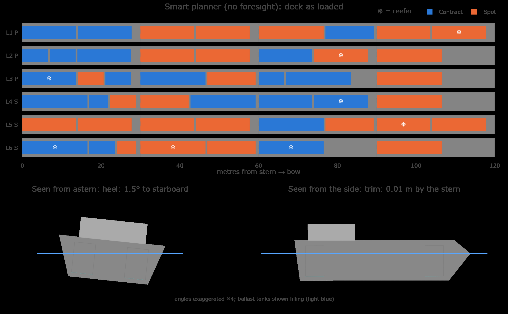
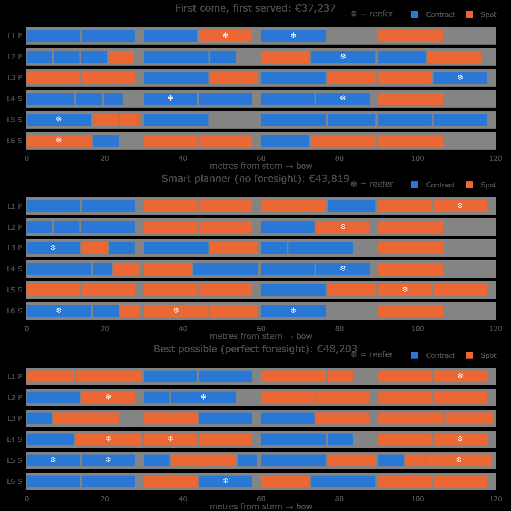

# 🚢 RoRo Yield Optimizer

**v2** · adds ship stability and a smart planner that has no foresight · the original game lives at tag [`v1.0`](https://github.com/vincenzotestini02-spec/roro-yield-optimizer/tree/v1.0)

**Can you load a Ro-Ro ferry better than an algorithm?** Play the booking planner for one sailing, then see what a MILP optimizer would have accepted, and why.

**▶ Live app:** _link added after deployment_ · no install, no login, about 3 minutes to play.



## The problem

Ferry deck space is perishable: once the ship sails, an empty lane-metre is revenue lost for good.
Operations wants a full, safe deck; Commercial wants the highest-paying cargo; Key Accounts have contracts that guarantee them space.
Accepting bookings first come, first served (FCFS) lets early, low-rate cargo crowd out late, high-rate spot cargo.
The question is which bookings to accept, and where to put them, so the sailing earns the most per lane-metre without breaking a contract.

## How to play

1. **① Play.** 60 booking requests arrive one by one for tomorrow's sailing (MV Nordic Bridge, Esbjerg → Immingham, 5 lanes × 120 m, a busy sailing with demand at 130% of the deck, each lane split into 4 zones from stern to bow). Accept or reject each, and choose **"🤖 App places them"** or **"✋ I place them"** (you pick the zone). Switch on **"💡 Advisor"** to see a verdict on every request. The deck drawing and the gauges (lane-metres, deadweight, reefer plugs, contract metres, margin, heel, trim, ballast) update live. Units that do not fit or would break the stability limits are refused, and you are warned when the contract guarantee is at risk.
2. **② Reveal.** Four contenders side by side: **You**, **First come, first served**, **Smart planner (no foresight)** and **Best possible (perfect foresight)**, with their decks drawn, an advisor table for your decisions, and the few decisions that cost you the most, each with a one-line reason. Download any plan as PDF or CSV, or copy a link that shows the same result to someone else.
3. **③ Lab.** Change the rules with sliders (number of requests, contract share, spot price level, guaranteed contract metres, lanes, lane length, deadweight, reefer plugs, lashing gap, random seed) and watch the optimizer and FCFS re-plan; the smart planner runs on demand, with a button, because it takes a while. The stability limits (max heel, max trim, ballast tank capacity, ballast cost) are sliders too. Download the loading manifest as CSV. Pick a vessel preset (demo ferry 600 lane-m, RoPax freight deck about 1,800 lane-m, short-sea RoRo about 2,500 lane-m; typical rounded figures, not named ships), set lost space (broken stowage) and the hull's stability constants, download the plan as PDF or CSV, and share the settings as a link.



_The v2 screenshots are rendered from the app's own figures (`deck_figure`, `ship_figure`) with Kaleido, not captured from a browser window._

## The model

Every method (you, FCFS, smart planner, optimizer) is scored on the same objective: **commercial margin, minus a penalty for every metre of contract cargo below the Key Account guarantee, minus the cost of the ballast the plan needs.**
The optimizer is a mixed-integer linear program (MILP) that decides which bookings to accept *and* which zone of which lane each one goes in, so every deck drawing is a real stowage plan.

Every lane is cut into 4 zones (zone 0 at the stern ramp, zone 3 at the bow). For booking $i$ and slot $s$ (a lane and a zone), $y_{i,s} \in \{0,1\}$ means "load $i$ in slot $s$"; $sf \ge 0$ is the contract shortfall in metres and $b_k \ge 0$ the ballast in tank $k$ (port, starboard, fore, aft).

$$
\max \; \sum_i m_i \sum_s y_{i,s} \;-\; p \cdot sf \;-\; c_b \sum_k b_k
$$

subject to

$$
\begin{aligned}
&\textstyle\sum_s y_{i,s} \le 1 && \forall i \quad \text{(each booking loaded at most once)}\\
&\textstyle\sum_i (L_i + g)\, y_{i,s} \le Z_s && \forall s \quad \text{(zone length, with lashing gap } g\text{)}\\
&\textstyle\sum_i w_i \sum_s y_{i,s} + \sum_k b_k \le W && \text{(deadweight, ballast included)}\\
&\textstyle\sum_{i \in \text{reefer}} \sum_s y_{i,s} \le P && \text{(reefer plugs)}\\
&sf \ge F - \textstyle\sum_{i \in \text{contract}} L_i \sum_s y_{i,s} && \text{(soft contract floor } F\text{)}\\
&0 \le b_k \le \text{tank capacity} && \forall k \quad \text{(ballast tanks)}\\
&|\text{heel moment after ballast}| \le H, \quad |\text{trim moment after ballast}| \le T && \text{(see Stability)}
\end{aligned}
$$

where $m_i$ is the booking's margin (length × rate + reefer fee − handling cost), $L_i$ its length, $w_i$ its weight, $Z_s$ the length of zone $s$, $p$ the penalty per missing contract metre (€200/m by default) and $c_b$ the ballast cost (€5/t by default).

It is solved with **HiGHS** (open source) through PuLP. A 3-second time limit keeps the app responsive, and the MILP is warm-started from the best of FCFS and the other plans on screen (yours and the smart planner's in the Reveal), so the benchmark is never worse than the plans it is compared with. The optimizer sees the whole booking queue in advance, so it is labelled *"Best possible (perfect foresight)"*: a benchmark, not an online decision rule.

| KPI | Meaning |
|---|---|
| Score | Margin − contract-shortfall penalty − ballast cost (the number every method competes on) |
| Margin | Revenue − handling cost of the accepted units |
| RevPAL | Revenue per available lane-metre |
| Deck utilisation | Lane-metres used (incl. lashing gaps) / total lane-metres |
| Deadweight used | (Cargo + ballast) / maximum deadweight |
| Reefer plugs | Refrigerated units loaded / plugs on board |
| Contract shortfall | Metres of contract cargo missing below the guarantee |
| Ballast | Tonnes of water ballast the plan needs, and its cost (€5/t by default) |
| Heel | Residual list in degrees after ballast (limit 2.0° by default) |
| Trim | Residual bow/stern difference in metres after ballast (limit 0.5 m by default) |
| Yield vs FCFS | % gain of the score over first come, first served |


## Stability

Cargo weight sitting off-centre makes the ship list (heel) or sit bow-down or stern-down (trim). v2 checks both.

- **Model.** Each unit's weight times its position gives a transverse moment (lane offset from the centreline) and a longitudinal moment (zone position from midships). Residual heel is `atan(net moment / (displacement × GM))` and residual trim is `net moment / (MTC × 100)`. Defaults: displacement 8,000 t, GM 1.5 m, MTC 100 t·m/cm.
- **Limits.** Max heel **2.0°** and max trim **0.5 m** after ballast, both adjustable in the Lab.
- **Ballast.** Four tanks (port, starboard, fore, aft), 300 t each, €5/t. For any plan the minimum ballast is closed form: the part of each moment above its limit, divided by the tank's lever arm (by default 9 m for the side tanks and 0.4 × lane length, i.e. 48 m, for the end tanks), goes into the tank on the light side. The same rule scores every method, so no method gets cheaper ballast than another. A plan is infeasible if that ballast exceeds a tank's capacity or pushes cargo plus ballast above the deadweight limit.

**Honest disclaimer:** this stability model is linear and simplified. It is a teaching model, not a class-approved loading computer, and it does not replace one.

The setting follows the formulations compared in Thomsen, Levinsen, Pacino & Reinhardt (DTU / DFDS A/S), *RoRo stowage planning: a systematic study of mathematical formulations* (2026), reduced here to a single deck with linear moments.

## Smart planner (no foresight)

The optimizer sees every booking before it decides, which no real planner can. The **smart planner** (also behind the in-game **💡 Advisor**) decides one request at a time, using only what a real planner would know:

- **Information set:** the current request, all past requests (accepted or not), its own deck, "request k of n", and the demand distribution (`ScenarioParams`). It is never given the bookings still to come, and the parameters it gets carry a neutral random seed, so it cannot regenerate this sailing either; its own sampling seed is a SHA-256 hash of the game seed. That keeps the two seeds separate in the code, so verdicts repeat per game without the planner ever reading the game seed; it is not a secret, because game seeds are small numbers that could be tried one by one. The real guarantee is the restricted view above, not the hash.
- **K sampled futures:** for the current request it samples K possible rest-of-sailing demand streams from that distribution (K = 20 by default; the app reads `RORO_ADVISOR_K`).
- **LP relaxation:** in each future it solves two LP relaxations of the model above with the deck's loads fixed: (a) the current unit loaded where the auto-placement rule puts it, (b) the unit rejected. The difference is that future's gain.
- **Accept rule:** accept if and only if the mean gain over the K futures is positive and the unit can be loaded. A request that cannot be loaded is refused without solving anything.

The idea is the one behind slot-allocation revenue management in liner shipping: keep space for cargo that is likely to pay more later (Zurheide & Fischer, "A revenue management slot allocation model for liner shipping networks", *Maritime Economics & Logistics* 14, 2012; see also Main, "Optimizing Roll-on/Roll-off Stowage Planning", PhD thesis, DTU, 2024).

**Does it help?** It depends on how full the ship is. Mean score over 30 synthetic sailings per level, with K = 20, on the game's 600 lane-metre deck:

| Demand | Requests | Demand / deck | FCFS | Smart planner | Vs FCFS | Lost to FCFS | Perfect foresight |
|---|---:|---:|---:|---:|---:|---:|---:|
| Low | 35 | 76% | 32,254 | 32,254 | 0.0% | 0 of 30 | 32,423 |
| Normal | 50 | 108% | 35,070 | 36,874 | +5.1% | 4 of 30 | 41,321 |
| High | 60 | 130% | 34,926 | 38,259 | +9.5% | 2 of 30 | 42,923 |

Here the planner knows how many requests will arrive, which a real planner would not. A tighter deck raises the percentage gain, not total profit. It only knows the demand distribution, not this sailing's future, so a single sailing can go against it; the advantage shows on average.

**Live timings (v3 on Google Cloud Run, 1 vCPU, 2 GiB, measured 2026-11-09):** advisor verdict median 2.5 s, max 2.7 s over 10 verdicts; first plan (FCFS and optimizer) 3.3 s.

## Academic grounding

The lane-assignment formulation is a simplified, one-deck version of the lane-based stowage model in
*Optimization of stowage plans for RoRo ships* (Øvstebø, Hvattum & Fagerholt, 2011), as benchmarked in
*RoRo stowage planning: a systematic study of mathematical formulations* (Thomsen, Levinsen, Pacino & Reinhardt, 2026).

What this version simplifies: one deck instead of several, lanes cut into four zones by length only, a linear stability model, and no loading sequence.
What it changes: the pseudo-revenue objective is replaced by real commercial margin, and optional vs. required cargo is realised as a soft Key Account floor with a per-metre penalty, and ballast is priced into the score. The online decision rule draws on Zurheide & Fischer (2012) and Main (2024).

## Roadmap

- **Done in v2:** stability (heel, trim, closed-form ballast, four zones per lane) and the online advisor (smart planner with no foresight).

### v3: planner tool plus game

v3 is a separate app with its own link; the Streamlit v2 app stays as it is.

- **App:** a FastAPI back end and a React front end in one service, hosted on Hugging Face Spaces.
- **Planner:** upload an Excel file of accepted bookings, all of them mandatory; get a first plan; assess each new request; re-plan while units are not yet on board.
- **Game:** Game, Reveal and Lab stay. Units can be moved, and the Advisor suggests a move only when it earns more than its handling cost.
- **Planning features:** broken stowage as a percentage, space reserved per customer, PDF export and shareable links, vessel presets, several discharge ports, and deck heights with deck and axle load limits.
- **Advisor:** three answers (accept, reject, "your call") so it rejects only when the sampled futures clearly agree. A test compares sampled futures with an expected-value rule, in the spirit of Main (2024).
- **Default deck:** 5 lanes of 120 m, shown as a high-demand sailing, next to results for low, normal and high demand.
- **Demand forecast:** planner assumptions first; then a monthly demand level from public data (DFDS monthly volumes, UK port freight statistics, Eurostat), kept only if it beats a simple seasonal baseline; then models trained on a company's own booking history, starting with LightGBM. Sailing-level detail stays simulated, and labelled so, until real bookings are available.
- **Cancellations and no-shows:** with company data, estimate which bookings will not sail, following Ränkeskog (2023), and show it as a risk indicator only.

### Later, if it proves its value

Each item is added only if it measurably beats the simpler version.

- **Detailed deck model:** a grid with obstacles, ramps, routes and loading order, and rotations of up to seven ports.
- **Heavier optimization:** continuous re-planning over scenarios, uncertain arrival times, and a HiGHS, Gurobi and heuristic comparison on large models.
- **Advanced forecasting:** neural network ensembles for calibrated uncertainty, once real data exists.
- **Commercial decisions:** overbooking and dynamic pricing, in the spirit of *A Dynamic Pricing Model for a Maritime Transportation Service Provider*.
- **Reinforcement learning:** an agent trained on the simulator and compared with the classical methods.
- **Validation:** thousands of simulated sailings, stress scenarios, statistical comparisons, and tests on real company data.
- **Platform:** separate API, job queue, database and model versioning.
- **Network:** several sailings and routes at once, towards *Combined maritime fleet deployment and inventory management with port visit flexibility in roll-on roll-off shipping*.
- **More cargo rules:** several decks with axle loads and dangerous-goods segregation, following *RoRo Ships Stowage Planning: Using a Novel MIP Model and Stability Constraints* and *A Two-Phase Stowage Approach for Passenger-Cargo RoRo Ship Based on 2D-KP Coping With Complex Rotation and Safe Navigation Constraints*.

## Run locally

Requires Python 3.11+ and Node.js 22+.

```bash
git clone https://github.com/vincenzotestini02-spec/roro-yield-optimizer.git
cd roro-yield-optimizer
python -m venv .venv
.venv\Scripts\activate          # Windows  (macOS/Linux: source .venv/bin/activate)
pip install -r requirements.txt -r requirements-dev.txt
npm --prefix web ci
npm --prefix web run build
uvicorn server.main:app --port 8000   # then open http://localhost:8000
pytest -q -m "not slow"               # fast engine and API tests
npm --prefix web test -- --run        # interface tests
npm --prefix web exec playwright test # browser tests, using installed Chrome
```

The engine (`roro_yield/`: models, demand simulator, deck state, stability, FCFS, MILP optimizer, advisor, KPIs, explainer, manifest) is independent of the API (`server/`) and the React interface (`web/`), so it can be reused behind an API or another interface.

## Synthetic data

All bookings, customers, rates, the vessel and the route are **synthetic but realistic**, generated from a seeded simulator (unit sizes such as 13.6 m semi-trailers and 16.5 m accompanied trucks, contract rates of €45–60/m, spot rates of €75–110/m, reefer plug fees). **This is not DFDS data.**

---

Built by **Vincenzo Testini**, MSc Industrial & Management Engineering at DTU · [LinkedIn](https://www.linkedin.com/in/vincenzo-testini-5a2b14243)
