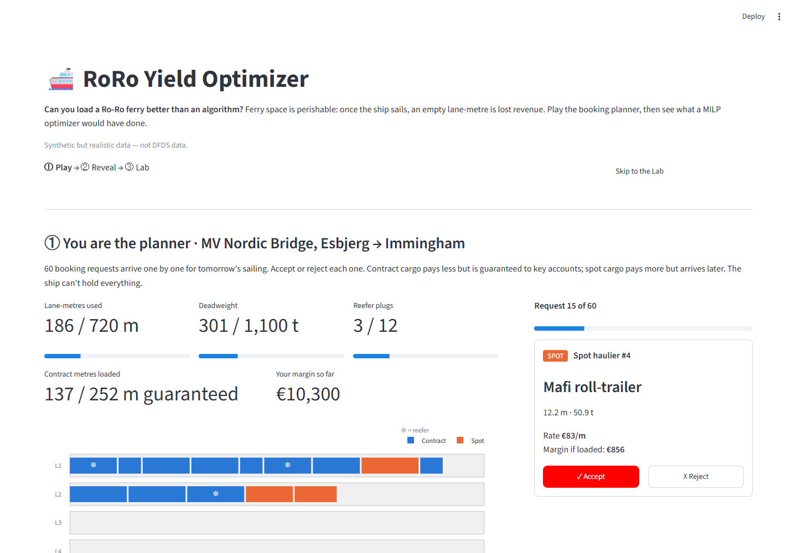
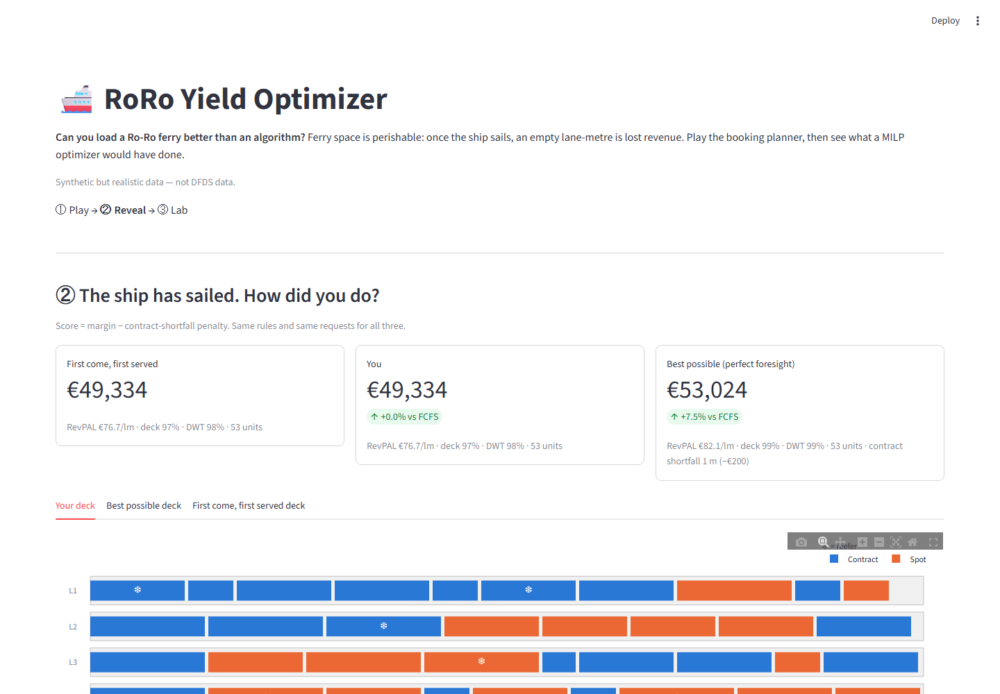
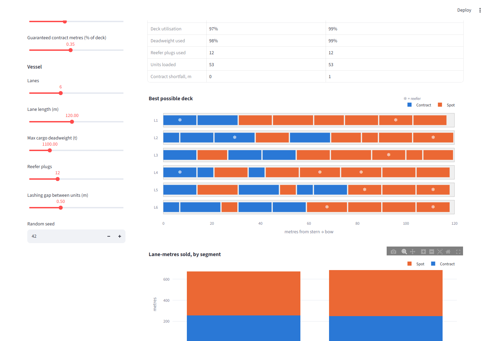

# 🚢 RoRo Yield Optimizer

**Can you load a Ro-Ro ferry better than an algorithm?** Play the booking planner for one sailing, then see what a MILP optimizer would have accepted, and why.

**▶ Live app:** _link added after deployment_ · no install, no login, about 3 minutes to play.



## The problem

Ferry deck space is perishable: once the ship sails, an empty lane-metre is revenue lost for good.
Operations wants a full, safe deck; Commercial wants the highest-paying cargo; Key Accounts have contracts that guarantee them space.
Accepting bookings first come, first served (FCFS) lets early, low-rate cargo crowd out late, high-rate spot cargo.
The question is which bookings to accept, and where to put them, so the sailing earns the most per lane-metre without breaking a contract.

## How to play

1. **① Play.** 60 booking requests arrive one by one for tomorrow's sailing (MV Nordic Bridge, Esbjerg → Immingham, 6 lanes × 120 m). Accept or reject each. The deck drawing and the gauges (lane-metres, deadweight, reefer plugs, contract metres, margin) update live. Units that do not fit are refused, and you are warned when the contract guarantee is at risk.
2. **② Reveal.** Your result is shown next to FCFS and the best possible plan, with all three decks drawn and the few decisions that cost you the most, each with a one-line reason.
3. **③ Lab.** Change the rules with sliders (number of requests, contract share, spot price level, guaranteed contract metres, lanes, lane length, deadweight, reefer plugs, lashing gap, random seed) and watch the optimizer and FCFS re-plan. Download the loading manifest as CSV.



## The model

Every method (you, FCFS, optimizer) is scored on the same objective: **commercial margin minus a penalty for every metre of contract cargo below the Key Account guarantee.**
The optimizer is a mixed-integer linear program (MILP) that decides which bookings to accept *and* which lane each one goes in, so every deck drawing is a real stowage plan.

For booking $i$ and lane $l$, $y_{i,l} \in \{0,1\}$ means "load $i$ in lane $l$"; $s \ge 0$ is the contract shortfall in metres.

$$
\max \; \sum_i m_i \sum_l y_{i,l} \;-\; p \cdot s
$$

subject to

$$
\begin{aligned}
&\textstyle\sum_l y_{i,l} \le 1 && \forall i \quad \text{(each booking loaded at most once)}\\
&\textstyle\sum_i (L_i + g)\, y_{i,l} \le C_l && \forall l \quad \text{(lane length, with lashing gap } g\text{)}\\
&\textstyle\sum_i w_i \sum_l y_{i,l} \le W && \text{(deadweight)}\\
&\textstyle\sum_{i \in \text{reefer}} \sum_l y_{i,l} \le P && \text{(reefer plugs)}\\
&s \ge F - \textstyle\sum_{i \in \text{contract}} L_i \sum_l y_{i,l} && \text{(soft contract floor } F\text{)}
\end{aligned}
$$

where $m_i$ is the booking's margin (length × rate + reefer fee − handling cost), $L_i$ its length, $w_i$ its weight and $p$ the penalty per missing contract metre (€200/m by default).

It is solved with **HiGHS** (open source) through PuLP. A 3-second time limit keeps the app responsive; on the default instance the result is within about 1% of the proven optimum. The optimizer sees the whole booking queue in advance, so it is labelled *"Best possible (perfect foresight)"*: a benchmark, not an online decision rule.

| KPI | Meaning |
|---|---|
| Score | Margin − contract-shortfall penalty (the number every method competes on) |
| Margin | Revenue − handling cost of the accepted units |
| RevPAL | Revenue per available lane-metre |
| Deck utilisation | Lane-metres used (incl. lashing gaps) / total lane-metres |
| Deadweight used | Cargo weight / maximum cargo deadweight |
| Reefer plugs | Refrigerated units loaded / plugs on board |
| Contract shortfall | Metres of contract cargo missing below the guarantee |
| Yield vs FCFS | % gain of the score over first come, first served |



## Academic grounding

The lane-assignment formulation is a simplified, one-deck version of the lane-based stowage model in
*Optimization of stowage plans for RoRo ships* (Øvstebø, Hvattum & Fagerholt, 2011), as benchmarked in
*RoRo stowage planning: a systematic study of mathematical formulations* (Thomsen, Levinsen, Pacino & Reinhardt).

What this version simplifies: one deck instead of several, lanes modelled by length only, no stability, trim or ballast, and no loading sequence.
What it changes: the pseudo-revenue objective is replaced by real commercial margin, and optional vs. required cargo is realised as a soft Key Account floor with a per-metre penalty.

## Roadmap

- **Online booking advisor.** Re-solve on every arrival and show a bid price ("accept only if it pays more than €X/m") during the game, in the spirit of *A revenue management slot allocation* model and *A Dynamic Pricing Model for a Maritime Transportation Service Provider*.
- **Multi-deck and stability.** Several decks, axle loads and stability constraints, following *RoRo Ships Stowage Planning: Using a Novel MIP Model and Stability Constraints* and *A Two-Phase Stowage Approach for Passenger-Cargo RoRo Ship Based on 2D-KP Coping With Complex Rotation and Safe Navigation Constraints*.
- **Fleet and network.** Several sailings and routes at once, towards *Combined maritime fleet deployment and inventory management with port visit flexibility in roll-on roll-off shipping*.
- **Real data.** Plug in historical booking streams instead of the synthetic generator.

## Run locally

Requires Python 3.11+.

```bash
git clone https://github.com/vincenzotestini02-spec/roro-yield-optimizer.git
cd roro-yield-optimizer
python -m venv .venv
.venv\Scripts\activate          # Windows  (macOS/Linux: source .venv/bin/activate)
pip install -r requirements.txt -r requirements-dev.txt
streamlit run streamlit_app.py
pytest -q                       # 90 tests
```

The engine (`roro_yield/`: models, demand simulator, FCFS, MILP optimizer, KPIs, explainer, manifest) is independent of the Streamlit UI (`app/`), so it can be reused behind an API or another interface.

## Synthetic data

All bookings, customers, rates, the vessel and the route are **synthetic but realistic**, generated from a seeded simulator (unit sizes such as 13.6 m semi-trailers and 16.5 m accompanied trucks, contract rates of €45–60/m, spot rates of €75–110/m, reefer plug fees). **This is not DFDS data.**

---

Built by **Vincenzo Testini**, MSc Industrial & Management Engineering at DTU · [LinkedIn](https://www.linkedin.com/in/vincenzo-testini-5a2b14243)
